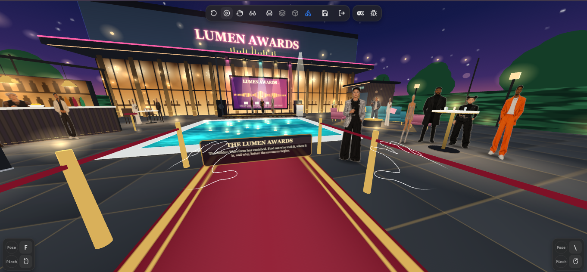
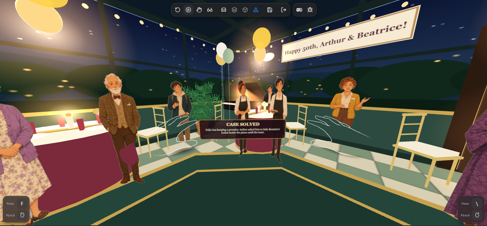
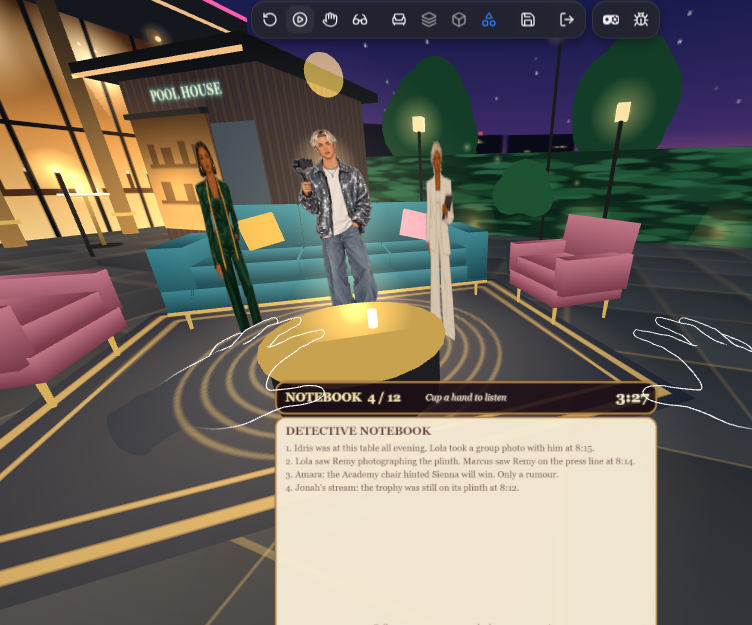

# Earshot

**A seated, hands-only audio mystery for Meta Quest.** Cup a hand to your ear to listen in on a party, catch the clues in the chatter, then name who took it.

**Play it:** https://earshot-app-sage.vercel.app/
**Jump to the gala (case 3):** https://earshot-app-sage.vercel.app/?case=3

Built for the Meta Horizon Start Developer Competition 2026. Track: Gaming. Build path: IWSDK (WebXR).



## The idea

You walk into a loud party and someone across the room says your name. Everything else drops away and you hear them. Earshot turns that into a game.

You sit in a room full of people talking at once. You can't speak and you can't walk up and interrupt. You can only listen. Turn toward a conversation, cup a hand behind your ear, and the noise around it falls away until you can hear every word.

## How to play

1. Put on headphones and open the link in a Quest browser, or in a desktop browser with the Immersive Web Emulator (see below).
2. Press **Enter VR**. On a desktop, **Preview on this screen** shows the flat version.
3. The host tells you what has gone missing. Then the room starts talking.
4. **Listen.** Face a group and lift a hand toward it. The muffled chatter opens up and the clue plays. A chime tells you it's caught.
5. **Accuse.** Point at an answer card and hold for about a second. A bar fills while you hold.

Everything works with your hands or your head. No controller is needed at any point. If hand tracking isn't available, looking straight at a group and holding your gaze works as a slower fallback. Every spoken line is captioned, so you can also read what is said.

### The three cases

| Case | Setting | What's different |
|---|---|---|
| 1. The Retirement Party | A warm parlor, 3 conversations | The teaching case. Catch one clue per group. |
| 2. The Golden Anniversary | A moonlit conservatory, 4 conversations | Pairs sit near and far, and the final answer happens at the piano. |
| 3. The Lumen Awards | A night-time awards gala with a pool, a stage and a green room, 6 conversations | Timed. You walk between groups, keep a notebook, and look down at it to accuse. |



### Case 3 in more detail

- You have seven minutes. The evidence is spread across six groups, and some groups are red herrings.
- A line only counts if you are close enough and listening while it is spoken.
- **Walking:** aim at a glowing marker and hold. The camera glides there, so you stay seated.
- **Notebook:** every clue you catch is written in. Collect enough notes, look down at the notebook, and you can accuse before the clock runs out.
- **Score:** key clues caught, time left and wrong guesses decide your rank, from *Lucky Guess* to *Perfect Ear*. Your best score is saved.



### Reasons to come back

- Case 2 unlocks when you solve Case 1, and Case 3 when you solve Case 2.
- Two wrong answers and the trail goes cold. You have to listen again before you can retry.
- Case 3 saves your best score and gives you a rank.
- Play on consecutive days and a streak shows in the case file.

### Captions

The game is built on sound, so every spoken line is captioned.

- The host's lines and the clues you catch show in a strip just under your eye line. Long speeches are split into short pieces that follow the voice.
- When you listen to a group, the words they are saying appear as they speak.
- Add `?nocaptions` to the address to hide them.

## Hand interaction

The game never needs a controller. Each frame it reads both hands from the player rig.

- **Listening** is a cup score from 0 to 1. It combines how close a hand is to your head (full strength within about 30 cm, fading out by 50 cm) and how well the direction from your head to your hand lines up with the direction to a group. A score of 0.7 or more counts as listening.
- **Choosing an answer** uses a pointing ray or your gaze, held for 1.2 seconds.
- **Walking** uses the same ray on a glowing marker, held for a shorter time.
- **Accusing in Case 3** is looking down at your notebook.
- **Gaze fallback** works for all of the above, so the game is playable seated and without hand tracking.

## The sound

Each conversation is its own audio source placed in the room and spatialised with HRTF, so you can tell where a group is without looking. Out of focus, a group is quiet and dull, like hearing it through a wall. As you look at it and raise a hand, a low-pass filter opens and the volume rises. The guests' mouths move to the level of the voice. The game also has procedural sound effects (chime, buzz, fanfare, applause, fireworks, whoosh) made with the Web Audio API.

## Run it yourself

You need Node.js 18 or newer.

```bash
cd earshot-app
npm install
npm run dev
```

Open the local address it prints. To test hands without a headset, install the **Immersive Web Emulator** extension for Chrome, set its **Input Mode** to **Hand**, and press **Enter VR**.

To build for hosting:

```bash
npm run build
```

The project deploys to Vercel from the `main` branch.

### Handy links

| Add to the address | What it does |
|---|---|
| `?case=1`, `?case=2`, `?case=3` | Starts that case directly and skips the locks |
| `?unlock` | Unlocks every case in the case file |
| `?test` | Shows a readout of look, cup and clue timing for each group |
| `?debug` | Shows errors on screen |
| `?reset` | Clears saved progress, best score and streak, to test as a first-time player |
| `?nocaptions` | Hides the captions |

Progress is stored in your browser's local storage under `earshot-progress`, `earshot-best` and `earshot-streak`. To reset it, add `?reset` to the address.

## How it's built

- **IWSDK** (Immersive Web SDK), **three.js** and the **Web Audio API**. No installs for the player, it runs from a link.
- The rooms are built in code. The parlor, the conservatory and the whole gala (sky, pool, pavilion, string lights, an LED wall that moves with the voices) use canvas-drawn textures, so there are almost no image files to load.
- Guests are painted figures with a closed-mouth and a talking pose, swapped by voice level.
- Walking is an eased glide of the player rig with a soft vignette, steering around the pool and the stage.

### Where things live

| File | What it does |
|---|---|
| `src/index.js` | Starts the world and registers the systems |
| `src/earshot.js` | The game: audio, hands, clues, the notebook, accusation, locks and streak |
| `src/room.js` | The parlor and conservatory rooms and their guests |
| `src/gala.js` | The Lumen Awards scene, walking markers, finale and fireworks |
| `src/cases.js` | The data for every case |
| `src/captions.js`, `src/captions-timed.js` | What the host and each clue say, and the words of each conversation with start and end times |
| `src/title.js`, `src/panel.js` | The title screen and in-world panel |
| `public/audio/`, `public/characters/` | The case audio and the character art |

### Adding a case

Add an entry to `src/cases.js` with its theme, groups, audio files, accusation questions and finale. Put the audio under `public/audio/` and the character pictures under `public/characters/`. The case file lists it automatically. The comments at the top of `cases.js` explain every field.

For captions, run `node make-captions.mjs` to list the new voice files. Then run `python transcribe-audio.py` (after `pip install faster-whisper soundfile soxr`) to get the text and timings, and paste them into `src/captions.js` and `src/captions-timed.js`.


## What's next

- More cases, each in a different room, with new voices and new rules for what makes a clue count.
- A daily case that's the same for everyone, so scores can be compared.
- A shared mode where a second player is in the room and you trade what you heard.
- Testing and tuning on a headset.